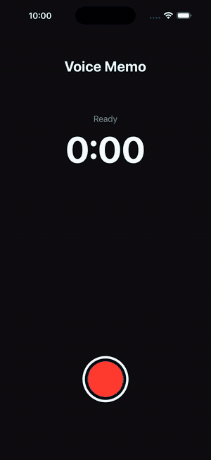
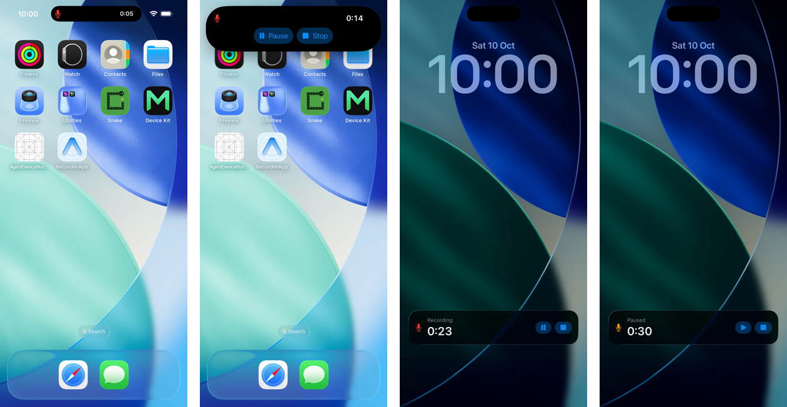

# Expo Live Activity — Voice Recorder

A small Expo app that shows a **Live Activity** for a voice recorder:
a timer on the **Lock Screen** and in the **Dynamic Island**, with **Pause / Resume / Stop** buttons.

Built with [`expo-widgets`](https://docs.expo.dev/versions/latest/sdk/widgets/) (alpha) and [`@expo/ui`](https://docs.expo.dev/versions/latest/sdk/ui/), with **no Swift code**.

📺 Video tutorial: [@seniormobiledev on YouTube](https://www.youtube.com/@seniormobiledev)

<p align="center">
  
</p>

<p align="center">
  
</p>

---

## What you will learn

| Topic | Where |
|---|---|
| The 4 places a Live Activity shows up (banner, compact, minimal, expanded) | `widgets/RecorderActivity.tsx` |
| The `'widget'` directive and its rules | `widgets/RecorderActivity.tsx` |
| A timer that iOS counts by itself (`timerInterval` + `pauseTime`) | `widgets/RecorderActivity.tsx` |
| Start / update / end a Live Activity | `recorder.ts` |
| Handle button taps from the Lock Screen | `recorder.ts` |
| Keep the app alive with background audio | `App.tsx`, `app.json` |

---

## How it works

```
 Your app (React Native)                       iOS
 ───────────────────────                       ───────────────────────────────
 recorder.ts                                   Widget extension (no React Native)
   RecorderActivity.start(props) ───────────►    small JS runtime runs the
   activity.update(props)        ───────────►    'widget' function → @expo/ui tree
   activity.end('immediate')     ───────────►    → real SwiftUI views
                                                  (Lock Screen + Dynamic Island)

   addUserInteractionListener  ◄──── event ────  user taps Pause / Stop
   (app decides, then calls update)
```

The important ideas:

1. **The layout runs in a separate runtime.** Everything the widget function needs must be **inside** the function.
   No hooks, no imports, no top-level constants.
2. **Props travel as JSON.** That is why the props are two numbers (`startedAt`, `pausedAt`) and not `Date` objects.
3. **iOS counts the timer for you.** We send the start time **once**. We do not update every second, because iOS limits how often a Live Activity can update.
4. **Buttons only send an event.** In a Live Activity, a button does not change the UI by itself.
   The app receives the event and calls `update()`. The app is the boss.

---

## Run it

Requirements: macOS, Xcode, an iOS 17+ simulator **with a Dynamic Island** (iPhone 15 Pro or newer).
This does **not** run in Expo Go — you need a development build.

```bash
npm install
npx expo run:ios
```

Then: tap **Record** → go to the Home Screen (compact view) → long press the island (expanded view) → lock the phone (`⌘L` in the Simulator) → tap **Pause / Resume / Stop** on the Lock Screen.

---

## Setup from scratch

```bash
npx create-expo-app@latest RecorderApp --template blank-typescript
cd RecorderApp
npx expo install expo-widgets @expo/ui
npx expo install expo-audio -- --legacy-peer-deps   # see "Gotchas"
```

`app.json`:

```json
{
  "expo": {
    "scheme": "myrecorder",
    "ios": { "bundleIdentifier": "com.seniormobiledev.recorder" },
    "plugins": [
      "expo-widgets",
      ["expo-audio", { "microphonePermission": "Record voice memos.", "enableBackgroundRecording": true }]
    ]
  }
}
```

You do **not** need a `widgets: []` entry for a Live Activity. That list is only for home screen widgets.

---

## Gotchas (found while building this)

- **`event.source` is the activity ID, not the name.**
  For a Live Activity, `addUserInteractionListener` gives you the **activity ID** as `source`,
  not the name you passed to `createLiveActivity`. Compare with `activity.getId()`:
  ```ts
  if (!activity || event.source !== activity.getId()) return;
  ```
- **Set `ios.bundleIdentifier`.** The config plugin builds the App Group from it (`group.<bundle id>`).
  Without it, the iOS setup is skipped.
- **The listener only runs while your app is alive.** A voice recorder uses background audio, so it stays alive.
  Other apps should update the activity from a server with push notifications (`enablePushNotifications`).
- **Buttons in a Live Activity need iOS 17+.**
- **Timer text is greedy.** Give the compact timer a fixed `frame({ width })` and use `monospacedDigit()`.
- **Banner buttons can wrap their labels.** Use `labelStyle('iconOnly')` in tight places.
- **npm peer conflict:** `@expo/ui` pulls `react-dom@19.3`, which can clash with the project's React version.
  `-- --legacy-peer-deps` fixes the install.
- `expo-widgets` is **alpha** — APIs may change.

---

## Project structure

```
App.tsx                       Demo screen (Record / Pause / Stop) + real mic recording with expo-audio
recorder.ts                   Start / update / end the Live Activity + button listener
widgets/RecorderActivity.tsx  The Live Activity layout (banner, compact, minimal, expanded)
app.json                      Config plugins for expo-widgets and expo-audio
```

Tested with Expo SDK 57, `expo-widgets` 57.0.x, Xcode 26.5, iOS 26.5 Simulator (iPhone 17 Pro Max).

---

## Links

- [Expo blog: Home screen widgets and Live Activities in Expo](https://expo.dev/blog/home-screen-widgets-and-live-activities-in-expo)
- [Expo Widgets docs](https://docs.expo.dev/versions/latest/sdk/widgets/)
- [Expo UI `Text` (timerInterval, pauseTime)](https://docs.expo.dev/versions/latest/sdk/ui/swift-ui/text/)

MIT License.
